# Blockchain Smart Sensor

## Sumário

1. Resumo Executivo e Arquitetura Sistêmica
2. Especificação de Hardware, Concorrência SPI e Parâmetros de Rádio
3. Especificação Formal do Protocolo MoT (`mot_packets.h`)
4. Arquitetura em Camadas do Nó Sensor vs. Arquitetura do Gateway
5. Máquina de Estados Finitos e Dinâmica dos Fluxos Operacionais
6. Servidor Central Nível 3 (`main.py`) e Camada de Dados Nível 4
7. Referências

---

# 1. Resumo e Arquitetura Sistêmica (Ponta a Ponta)

## 1.1 Contextualização Científica

## Contextualização

O monitoramento e a rastreabilidade de equipamentos são importantes para organizações que precisam controlar a utilização, a localização e a responsabilidade sobre seus ativos. Sistemas tradicionais de gerenciamento podem apresentar dificuldades para identificar quem está utilizando determinado equipamento, acompanhar seu histórico de movimentação e manter registros confiáveis sobre sua utilização.

Fundamentado no trabalho de **Yamaguti et al. (2025)**, que apresenta a integração entre Internet das Coisas (IoT), Blockchain e a metodologia **TpM+**, este projeto propõe uma solução de monitoramento e rastreabilidade de equipamentos utilizando comunicação LoRa, identificação RFID e gerenciamento centralizado. A implementação concentra-se na aquisição de dados, na comunicação entre dispositivos e no controle de custódia, seguindo a arquitetura de seis níveis utilizada como referência pela metodologia.

A solução contempla duas funcionalidades principais:

1. **Monitoramento ambiental:** coleta de temperatura e umidade por meio do sensor DHT22, juntamente com métricas de comunicação LoRa (RSSI/SNR) e contadores de transmissão, permitindo avaliar as condições ambientais e o desempenho da comunicação entre os dispositivos.

2. **Rastreabilidade e controle de custódia:** identificação de operadores e objetos por meio de RFID (RC522), permitindo registrar responsáveis, acompanhar o histórico de utilização e realizar transferências de custódia (*handover*) mediante confirmação dos envolvidos.

Justificativas arquiteturais de projeto:

| Decisão de projeto | Fundamentação |
|---|---|
| **Frame de tamanho fixo (24 bytes)** | Elimina campo de comprimento e parsing variável; reduz o tempo no ar (ToA) e o risco de fragmentação; permite validação trivial (`len == 24`) em todos os níveis (C++, Python, MQTT). |
| **`union` binária + `#pragma pack(1)`** | Permite utilizar os mesmos 24 bytes tanto para transmitir dados pelo rádio quanto para acessar os campos da estrutura, sem precisar converter ou copiar os dados. |
| **Acesso ao meio por CAD + backoff aleatório (CSMA/CA-like)** | LoRa não oferece detecção de colisão nativa; o *Channel Activity Detection* do RFM95 detecta preâmbulo LoRa e o recuo aleatório reduz colisões entre nós. |
| **Isolamento de barramento SPI por Chip Select em HIGH** | Três escravos heterogêneos (RFM95, RC522, GC9A01) compartilham SCK/MISO/MOSI; apenas um CS pode estar em LOW por vez. |
| **Arbitragem centralizada (Nível 3)** | Posse de objeto é um recurso exclusivo; um árbitro único evita estados divergentes (*split-brain*) entre nós. |
| **Polling centralizado** | O servidor controla a cadência (5 s) e a suspensão seletiva durante handover; nós respondem apenas quando consultados, reduzindo contenção no canal. |

## 1.2 Arquitetura em 4 Níveis

**Nível 1 — Nó Sensor Multifuncional (ESP32 PK-LoRa).** Aquisição de dados (DHT22), identificação física (RFID RC522), interface homem-máquina (display redondo GC9A01, três LEDs, botão) e pilha protocolar MoT em 6 camadas (PHY, MAC, NET, TRANSP, APP, DISPLAY).

**Nível 2 — Comunicação e Integração (LoRa ↔ Wi-Fi/MQTT).** Responsável pelos enlaces de comunicação entre os nós sensores, o gateway e o servidor central (Nível 3). Utiliza LoRa para a comunicação entre sensores e gateway, enquanto a integração com o servidor ocorre por Wi-Fi/MQTT (QoS 1). O gateway, implementado com o módulo LoRa JVTECH v2.0, atua como ponte bidirecional entre essas tecnologias, realizando o encaminhamento dos frames MoT, o controle de duplicatas e a coleta de métricas de enlace (RSSI/SNR de uplink).

**Nível 3 — Servidor Central e Árbitro de Rede (`main.py`).** Orquestra regras de negócio: provisionamento dinâmico (Join), autenticação de operadores, arbitragem de handover e polling ativo. Opera por USB/Serial (`GerenciadorSerial`) ou Nuvem/MQTT (`GerenciadorMQTT`).

**Operador IoT & Blockchain — Integração Externa (API REST/HTTP).** Componente externo responsável pela com serviços de IoT e Blockchain. Estabelece comunicação bidirecional com o Nível 3 por meio de requisições HTTP utilizando uma API REST, permitindo a troca de informações e a interação com as funcionalidades disponibilizadas pelo servidor central.

**Nível 4 — Persistência (`N4.py` + CSV).** Base cadastral (`pessoas.csv`, `sensores_cadastrados.txt`, `sessoes_ativas.json`) e registro histórico de dados brutos (`Dados_Brutos/Sessao_MoT_*.csv`).

**Nível 5 — Processamento e Análise de Dados (Python).** Responsável pelo processamento dos dados brutos armazenados no Nível 4, realizando tratamento, organização e transformação das informações coletadas. Gera conjuntos de dados processados para análise e visualização, mantendo a separação entre os registros originais e os resultados do processamento.

**Nível 6 — Gerência e Visualização (Python).** Interface de supervisão e administração do sistema, responsável pela visualização dos dados processados e pelo gerenciamento dos parâmetros operacionais. Permite consultar informações históricas, acompanhar os resultados das análises e configurar parâmetros utilizados pelo sistema, integrando as funções de monitoramento e gerenciamento.

<p align="center">
  
  <br>
  <em>Figura 1 — Arquitetura do sistema MoT.</em>
</p>

## 1.3 Diagrama Arquitetural Ponta a Ponta

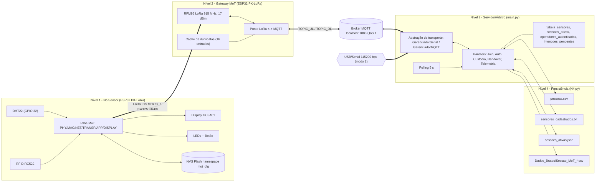

> Nota: o firmware de Gateway fornecido implementa apenas o transporte MQTT.

---

# 2. Especificação de Hardware, Concorrência SPI e Parâmetros de Rádio

## 2.1. Protótipos de Hardware

Para a implementação e validação experimental do protocolo MoT, foram utilizados dois dispositivos baseados no microcontrolador ESP32, responsáveis pela aquisição de dados e pela comunicação entre a rede LoRa e o servidor central.

### 2.1.1 Nó Sensor LoRa

O nó sensor foi desenvolvido utilizando a placa **PK-LoRa**, desenvolvida pela **Universidade Estadual de Campinas (Unicamp)**, em conjunto com um módulo **ESP32-WROOM-32 de 30 pinos**.

A plataforma integra comunicação LoRa e permite a conexão de periféricos utilizados no monitoramento ambiental e na identificação de operadores e objetos.

No protótipo, foram conectados o sensor de temperatura e umidade DHT22, o leitor RFID RC522, o display circular GC9A01 e os componentes de sinalização e interação.

<p align="center">
  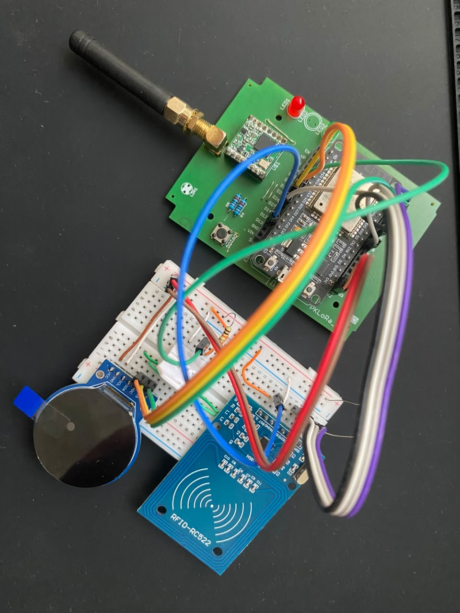
  <br>
  <em>Protótipo do Nó Sensor MoT.</em>
</p>

### 2.1.2 Gateway LoRa

Para o gateway, foi utilizado o **Módulo LoRa JVTECH v2.0**, adquirido no site da **JVTECH**.

O dispositivo é responsável por estabelecer a comunicação entre os nós sensores e o servidor central, funcionando como uma ponte bidirecional entre a rede LoRa e a infraestrutura Wi-Fi/MQTT.

O gateway recebe os pacotes transmitidos pelos sensores via LoRa e os encaminha ao broker MQTT por Wi-Fi. No sentido inverso, recebe mensagens do servidor por MQTT e as retransmite aos nós sensores por LoRa.

<p align="center">
  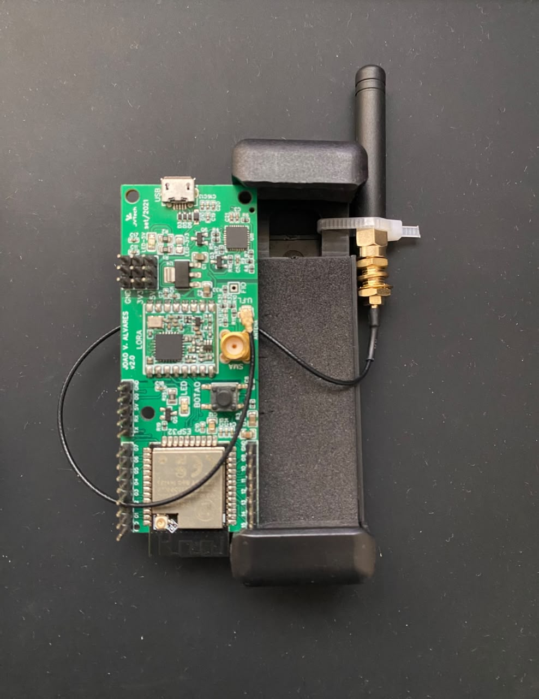
  <br>
  <em>Protótipo do Gateway LoRa.</em>
</p>


## 2.2 Mapeamento de Hardware (GPIO)

### 2.2.1 Nó Sensor (`BSS_Sensor_Display.ino` / `BSS_LoRa.ino`)

| Função | Símbolo | GPIO | Periférico | Observação |
|---|---|---|---|---|
| SPI SCK | `SCK_PIN` | 5 | Barramento compartilhado | RFM95, RC522, GC9A01 |
| SPI MISO | `MISO_PIN` | 19 | Barramento compartilhado | |
| SPI MOSI | `MOSI_PIN` | 27 | Barramento compartilhado | |
| LoRa CS | `NSS_PIN` | 18 | RFM95 | Ativo em LOW |
| LoRa Reset | `RST_PIN` | 14 | RFM95 | |
| LoRa IRQ | `DIO0_PIN` | 26 | RFM95 | |
| RFID CS | `RFID_SS` | 23 | RC522 | Ativo em LOW |
| RFID Reset | `RFID_RST` | 13 | RC522 | |
| Display CS | `TFT_CS` | 25 | GC9A01 | Ativo em LOW |
| Display D/C | `TFT_DC` | 33 | GC9A01 | |
| Display Reset | `TFT_RST` | 22 | GC9A01 | |
| Dados DHT22 | `DHTPIN` | 32 | DHT22 | |
| LED vermelho | `LED_VERMELHO_PIN` | 15 | LED | TX / erro |
| LED amarelo | `LED_AMARELO_PIN` | 2 | LED | Espera / handover |
| LED verde | `LED_VERDE_PIN` | 4 | LED | RX / sucesso |
| Botão | `BOTAO_PIN` | 39 | Botão | `INPUT`, ativo em LOW (pressionado = `LOW`) |

### 2.2.2 Gateway (`BSS_Gateway.ino` / `MoT_Gateway.ino`)

| Função | Símbolo | GPIO | Observação |
|---|---|---|---|
| SPI SCK | `SCK_PIN` | 5 | |
| SPI MISO | `MISO_PIN` | 19 | |
| SPI MOSI | `MOSI_PIN` | 27 | |
| LoRa CS | `NSS_PIN` | 18 | `SPI.begin(SCK, MISO, MOSI, NSS)` |
| LoRa Reset | `RST_PIN` | 14 | |
| LoRa IRQ | `DIO0_PIN` | 26 | |
| LED vermelho | `LED_VERMELHO_PIN` | 15 | Pisca 40 ms a cada TX de downlink |
| LED verde | `LED_VERDE_PIN` | 4 | 1000 ms na inicialização; 40 ms a cada uplink publicado |

## 2.3 Engenharia de Concorrência no Barramento SPI Compartilhado

O barramento SPI é *multi-drop* síncrono: SCK, MISO e MOSI são comuns a todos os escravos, e a seleção ocorre exclusivamente por CS dedicado. A regra de ouro é **no máximo um CS em nível LOW por vez**; qualquer escravo com CS em HIGH mantém MISO em alta impedância e ignora o tráfego. As três linhas de CS são `NSS_PIN = 18` (RFM95), `RFID_SS = 23` (RC522) e `TFT_CS = 25` (GC9A01).

Mecanismos implementados:

1. **Inicialização segura (`setup()`).** Antes de `SPI.begin(5, 19, 27)`, os três CS são configurados como `OUTPUT` e levados a `HIGH`, evitando seleção espúria durante o *boot*.
2. **Acessos diretos ao RFM95 (`1_PHY`).** `rfm95_readRegister()` e `rfm95_writeRegister()` baixam `NSS_PIN`, forçam `RFID_SS` e `TFT_CS` em `HIGH`, abrem a transação com `SPISettings(8E6, MSBFIRST, SPI_MODE0)`, transferem e liberam o CS.
3. **TX LoRa.** `Phy_radio_send_raw()` força `RFID_SS` e `TFT_CS` em `HIGH` antes de `LoRa.beginPacket()`.
4. **Display.** `Display_selecionar_spi()` força `NSS_PIN` e `RFID_SS` em `HIGH` antes de qualquer desenho; o CS do display é gerenciado pela biblioteca Adafruit (`Adafruit_GC9A01A tft(&SPI, TFT_DC, TFT_CS, TFT_RST)`). O barramento é reconfigurado por transação (display a 40 MHz, LoRa a 8 MHz).
5. **Leitura RFID.** Em `App_verificar_RFID()` e `App_ler_tag_com_timeout()`, `digitalWrite(NSS_PIN, HIGH)` é reafirmado antes de cada `PICC_IsNewCardPresent()`.
6. **Bloqueio travante.** Após autenticação do operador, o nó entra em laço `while (!objetoLido)` que mantém `NSS_PIN` em `HIGH` a cada iteração (com `yield()` + `delay(20)` para alimentar o *watchdog*), garantindo que nenhuma operação LoRa interfira na leitura crítica do RC522. Durante esse laço o rádio é **cego**: nenhum downlink é processado.

## 2.4 Perfil de Rádio Frequência (LoRa 915 MHz)

| Parâmetro | Nó Sensor | Gateway | Justificativa |
|---|---|---|---|
| Frequência | `915E6` Hz | `915E6` Hz | Banda ISM 915 MHz |
| Potência TX | **10 dBm** (`txPower 10`, "estabilidade elétrica") | **17 dBm** (`txPower 17`) | Sensor: evita *brown-out* em ESP32 com periféricos concorrentes; Gateway: maior cobertura de downlink |
| Spreading Factor | 7 | 7 | Menor ToA, maior taxa |
| Largura de banda | 125 kHz (`125E3`) | 125 kHz | |
| Coding Rate | 4/8 (`setCodingRate4(8)`) | 4/8 | Máxima redundância FEC |
| SPI (acesso a registradores RFM95) | 8 MHz, `MSBFIRST`, `SPI_MODE0` | 8 MHz, `MSBFIRST`, `SPI_MODE0` | `SPISettings(8E6, MSBFIRST, SPI_MODE0)` |
| SPI display | 40 MHz (`tft.begin(40000000)`) | n/a | |
| Tamanho do payload | 24 bytes | 24 bytes | |
| Backoff CAD | 25–75 ms | 15–50 ms | |

**Tempo no ar (derivado, não presente no código).** Com SF = 7, BW = 125 kHz, CR = 4/8, cabeçalho explícito, CRC desligado (padrão da biblioteca), preâmbulo de 8 símbolos e PL = 24:

$$T_{sym}=\frac{2^{SF}}{BW}=\frac{128}{125000}=1{,}024\ \text{ms}$$

$$n_{payload}=8+\max\left(\left\lceil\frac{8PL-4SF+28+16CRC-20H}{4(SF-2DE)}\right\rceil(CR+4),0\right)=8+7\cdot 8=64$$

$$ToA=(8+4{,}25+64)\,T_{sym}\approx 78{,}1\ \text{ms}$$

---

# 3. Especificação Formal do Protocolo MoT (`mot_packets.h` — 24 Bytes)

## 3.1 Engenharia de Memória

`#pragma pack(push, 1)` desativa o *padding* de alinhamento do compilador, garantindo que `sizeof(MotHeader) = 13` e que cada payload ocupe exatamente 11 bytes (13 + 11 = 24). A `union MotFrame` sobrepõe o vetor plano `uint8_t raw[24]` (usado em `LoRa.readBytes`, `LoRa.write` e `mqttClient.publish`) a visões tipadas (`header`, `join`, `auth`, `obj_custody`, `handover`, `clima`). Isso produz serialização/desserialização *zero-copy*: não há cópia nem conversão de *endianness* de campos individuais; o *layout* na memória é o *layout* no ar. O mesmo arquivo é replicado em `mot_packets_Sensor.h` e `mot_packets_Gateway.h` (conteúdo idêntico), garantindo coerência binária entre os firmwares; o Python replica os offsets manualmente.

## 3.2 Cabeçalho Padrão (`MotHeader` — Bytes 0 a 12)

| Byte | Campo | Camada/Grupo | Descrição | Escrito por |
|---|---|---|---|---|
| 0 | `config` | MoT Core | Configuração (valor usado: `0x01`) | APP (sensor) / `criar_frame_base` (Python) |
| 1 | `pkt_type` | MoT Core | Tipo do pacote (`MotPacketType`) | APP / Python |
| 2 | `rssi_dl` | Física | RSSI do downlink medido **no sensor**, codificado | PHY sensor (`Phy_radio_send_raw`) |
| 3 | `snr_dl_msb` | Física | SNR DL, byte alto | PHY sensor |
| 4 | `snr_dl_lsb` | Física | SNR DL, byte baixo | PHY sensor |
| 5 | `rssi_ul` | Física | RSSI do uplink medido **no gateway**, codificado | Gateway (`Phy_mqtt_send_UL`) |
| 6 | `snr_ul_msb` | Física | SNR UL, byte alto | Gateway |
| 7 | `snr_ul_lsb` | Física | SNR UL, byte baixo | Gateway |
| 8 | `packet_id` | Rede | Identificador sequencial (8 bits, *wrap* em 256) | NET sensor (`seq_packet_local`) / Gateway (`seq_packet_gw`) |
| 9 | `src_addr` | Rede | Endereço de origem | NET sensor / Gateway / Python |
| 10 | `dest_addr` | Rede | Endereço de destino (`0xFF` = broadcast) | NET sensor / Python |
| 11 | `net_reserved` | Rede | Reservado (0) | NET |
| 12 | `hop_limit` | Rede | Limite de saltos (padrão 1) | NET sensor / Gateway |

## 3.3 Modelagem Matemática das Métricas de Enlace e Clima

### 3.3.1 RSSI (Bytes 2 e 5)

**Codificação (C++, `Phy_radio_send_raw` e `Phy_mqtt_send_UL`).** Sendo $R$ o RSSI em dBm (inteiro) e $b$ o byte transmitido:

$$
b=\begin{cases}
127, & R>-10{,}5\\[2pt]
2\,(R+74), & -74\le R\le -10{,}5\\[2pt]
\big(2\,(R+74)+256\big)\bmod 256, & R<-74
\end{cases}
$$

| Faixa de RSSI | Fórmula C++ | Resolução |
|---|---|---|
| $R > -10{,}5$ dBm | `127` (saturação) | — |
| $-74 \le R \le -10{,}5$ dBm | `(R + 74) * 2` | 0,5 dBm/LSB (valores 0…126) |
| $R < -74$ dBm | `((R + 74) * 2) + 256` | 0,5 dBm/LSB (valores ≥ 128 até 255) |

**Decodificação (Python, `decodificar_rssi`).**

$$
R=\begin{cases}
-10{,}0, & b=127\\[2pt]
\left\lfloor\dfrac{b-256}{2}-74\right\rfloor, & b\ge128\\[6pt]
\left\lfloor\dfrac{b}{2}-74\right\rfloor, & b<127
\end{cases}
$$

### 3.3.2 SNR (Bytes 3–4 DL e 6–7 UL)

**Codificação (C++).** $s=\lfloor 100\cdot SNR\rfloor$ (cast `(int)`), `msb = (uint8_t)(s / 256)`, `lsb = (uint8_t)(s % 256)`.

**Decodificação (Python, `decodificar_snr`).** Interpretação em complemento de dois de 16 bits:

$$
v=(msb\ll 8)\,|\,lsb,\qquad
v\leftarrow \begin{cases}v-65536,& v\ge 0x8000\\ v,&\text{caso contrário}\end{cases},\qquad
SNR=\frac{v}{100}\ \text{dB}
$$

### 3.3.3 Temperatura e Umidade

| Grandeza | Codificação (sensor) | Decodificação (Python) | Falha de leitura |
|---|---|---|---|
| Temperatura (Byte 19) | `(uint8_t)(T + 40.0f)` | `T = raw − 40.0` | `0xFF` → `None` |
| Umidade (Byte 20) | `(uint8_t)umidade` (%) | `raw` (%) | `0xFF` → `None` |

$$T_{byte}=\lfloor T_{^\circ C}+40{,}0\rfloor,\qquad T_{^\circ C}=T_{byte}-40{,}0$$

Falha do DHT22 (`dht.getStatus() != ERROR_NONE`) grava `0xFF` em ambos os campos e o display **não** é atualizado.

## 3.4 Dicionário de Tipos de Pacote (`MotPacketType` — Byte 1)

| Código | Nome | Sentido | Finalidade |
|---|---|---|---|
| `0x01` | `PKT_JOIN_REQUEST` | UL (Sensor → Servidor) | Solicitação de comissionamento; carrega MAC de fábrica |
| `0x02` | `PKT_JOIN_ACCEPT` | DL (Servidor → Sensor) | Atribuição de `Node_ID`, ID do gateway e hop limit |
| `0x10` | `PKT_AUTH_REQUEST` | UL | Validação do crachá do Operador |
| `0x11` | `PKT_AUTH_RESPONSE` | DL | Resultado da autenticação (1 = aprovado, 0 = negado) |
| `0x12` | `PKT_OBJ_CUSTODY_REQ` | UL | Solicitação de posse de Objeto (UID operador + UID objeto) |
| `0x13` | `PKT_OBJ_CUSTODY_RESP` | DL | Resposta de posse: 1 = Concedido, 2 = Retido por outro nó, 0 = Negado |
| `0x20` | `PKT_DATA_POLL` | DL | Polling do servidor |
| `0x21` | `PKT_DATA_REPLY` | UL | Resposta de clima + métricas + UID  |
| `0x30` | `PKT_CUSTODY_START` | UL | Botão 3 s: início de handover (pausa o polling do nó) |
| `0x31` | `PKT_CUSTODY_CONFIRMED` | DL | Notifica o Cedente que a custódia foi liberada |
| `0x32` | `PKT_CUSTODY_ABORT` | UL | Timeout/cancelamento do handover (retoma polling) |
| `0x33` | `PKT_HANDOVER_AGREED` | UL | Cedente leu Objeto + Crachá do Novo Operador |

## 3.5 Mapeamento dos 5 Payloads Modulares (Bytes 13 a 23)

### 3.5.1 `PayloadJoin` (Comissionamento)

| Bytes | Campo | Tipo | Descrição |
|---|---|---|---|
| 13–18 | `mac[6]` | `uint8_t[6]` | MAC de fábrica do ESP32 (eFuse) |
| 19 | `assigned_id` | `uint8_t` | Novo `Node_ID` atribuído (preenchido no `JOIN_ACCEPT`) |
| 20 | `gateway_id` | `uint8_t` | ID do Gateway (100) |
| 21 | `hop_limit` | `uint8_t` | Limite de saltos padrão (1) |
| 22–23 | `padding[2]` | `uint8_t[2]` | Zerados |

No `JOIN_REQUEST`, apenas os bytes 13–18 são preenchidos.

### 3.5.2 `PayloadAuth` (Autenticação de Pessoa)

| Bytes | Campo | Descrição |
|---|---|---|
| 13–16 | `uid[4]` | UID do cartão do Operador |
| 17 | `auth_status` | 1 = Aprovado, 0 = Negado (somente no `AUTH_RESPONSE`; 0 no request) |
| 18–23 | `padding[6]` | Zerados |

### 3.5.3 `PayloadObjCustody` (Posse de Objeto)

| Bytes | Campo | Descrição |
|---|---|---|
| 13–16 | `uid_operador[4]` | UID do Operador autenticado |
| 17–20 | `uid_objeto[4]` | UID do Objeto monitorado |
| 21 | `status` | Resposta do servidor (ver tabela abaixo; 0 no request) |
| 22–23 | `padding[2]` | Zerados |

| Status | Significado | Ação no sensor |
|---|---|---|
| 1 | Concedido | `possuiCustodia = true`, estado → `ESTADO_CUSTODIA_ATIVA`, persiste `uid_operador`, `uid_objeto`, `tem_custodia` na NVS; LED verde 800/1000 ms |
| 2 | Retido por outro nó | Guarda `uid_objeto` em RAM, LED amarelo pisca 4× (120 ms/120 ms), permanece em `ESTADO_AGUARDANDO_OBJETO` em escuta passiva |
| 0 | Negado | LED vermelho 1000 ms (o firmware trata qualquer status ≠ 1 e ≠ 2, ou timeout, como recusa). O servidor Python fornecido não emite 0 |

### 3.5.4 `PayloadHandover` (Acordo de Transferência Física)

| Bytes | Campo | Descrição |
|---|---|---|
| 13–16 | `uid_objeto[4]` | Objeto sendo liberado |
| 17–20 | `uid_novo_op[4]` | Crachá do novo operador lido no Cedente (zerado em `CUSTODY_START`/`ABORT`) |
| 21–23 | `padding[3]` | Zerados |

Em `PKT_CUSTODY_START` e `PKT_CUSTODY_ABORT`, apenas `uid_objeto` é relevante (Python lê bytes 13–16).

### 3.5.5 `PayloadClima` (Transporte + Telemetria + Custódia)

| Byte | Campo | Grupo | Descrição |
|---|---|---|---|
| 13 | `transp_reserved` | TRANSP | 0 (reservado) |
| 14 | `echo_dl_cnt_msb` | TRANSP | Eco do contador de DL entregues (MSB) |
| 15 | `echo_dl_cnt_lsb` | TRANSP | Eco do contador de DL (LSB) |
| 16 | `ul_pkt_cnt_msb` | TRANSP | Contador de UL enviados (MSB) |
| 17 | `ul_pkt_cnt_lsb` | TRANSP | Contador de UL (LSB) |
| 18 | `hw_code` | APP | Código do hardware (1 = PK-LoRa) |
| 19 | `temperature` | APP | °C + 40 (0xFF = falha) |
| 20 | `humidity` | APP | % (0xFF = falha) |
| 21–23 | `uid_custodia[3]` | APP | 3 primeiros bytes do UID do objeto sob custódia |

---

# 4. Arquitetura em Camadas do Nó Sensor vs. Arquitetura do Gateway

## 4.1 Pilha Protocolar do Nó Sensor (Camadas 1 a 6)

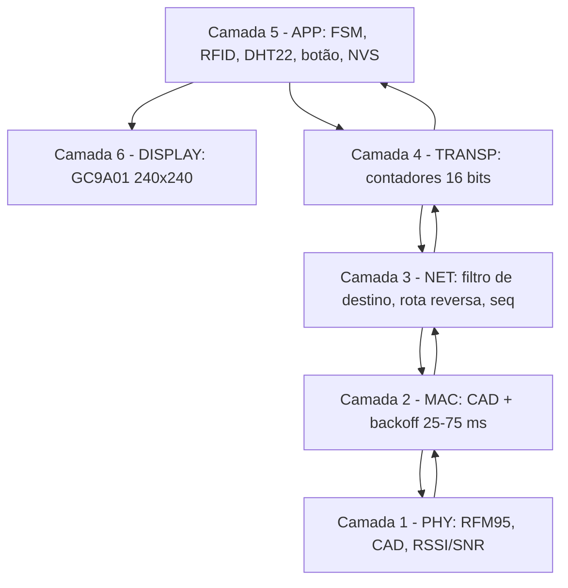

### Camada 1 — PHY (`1_PHY_Sensor.ino`)

- **Acesso a registradores:** `REG_OP_MODE = 0x01`, `MODE_LORA = 0x80`, `MODE_STANDBY = 0x01`, `MODE_CAD = 0x07`, `REG_IRQ_FLAGS = 0x12`, `IRQ_CAD_DONE_MASK = 0x04`, `IRQ_CAD_DETECTED = 0x01`.
- **CAD (`Phy_canal_ocupado_CAD`):** (1) standby LoRa; (2) limpa IRQ (`0xFF`); (3) modo CAD; (4) *polling* de `CAD_DONE` com **timeout de 50 ms** (`millis() + 50`); (5) lê flags, limpa IRQ, retorna a standby; (6) retorna `flags & IRQ_CAD_DETECTED`.
- **Recepção DL (`Phy_radio_receive_DL`):** `LoRa.parsePacket()`; se `packetSize >= 24`, `LoRa.readBytes(frameDL.raw, 24)`, pisca LED verde 20 ms, captura `RSSI_dBm_DL = LoRa.packetRssi()` e `SNR_DL = LoRa.packetSnr()`, e despacha para `Mac_radio_receive`.
- **Injeção de métricas de DL no UL (`Phy_radio_send_raw`):** aplica a codificação de RSSI (Seção 3.3.1) em `frameUL.header.rssi_dl` e a de SNR em `snr_dl_msb/lsb` (`SNR_DL_inteiro = (int)(SNR_DL * 100)`), garante `RFID_SS` e `TFT_CS` em HIGH, acende o LED vermelho durante `beginPacket/write/endPacket`.

### Camada 2 — MAC (`2_MAC_Sensor.ino`)

```text
tentativas = 0
enquanto (CAD detecta canal ocupado E tentativas < 5):
    recuo = random(25, 75) ms ; delay(recuo) ; tentativas++
Phy_radio_send_raw()      // transmite mesmo se o canal permanecer ocupado após 5 tentativas
```

O recuo é uniforme em [25, 75) ms (`random(25, 75)`), com **até 5 tentativas**. Se o canal estiver livre na primeira verificação, imprime "Canal livre (CAD verificado)".

### Camada 3 — NET (`3_NET_Sensor.ino`)

- **Bypass de Join:** `PKT_JOIN_ACCEPT` é repassado diretamente a `Transp_radio_receive_DL()` sem filtro de endereço (nó ainda sem ID; a validação ocorre na APP via `memcmp` de 6 bytes do MAC).
- **Filtro de destino:** demais pacotes só são aceitos se `dest_addr == ID_sensor` ou `dest_addr == 0xFF`.
- **Rota reversa dinâmica:** `ID_gateway = src_addr` do pacote aceito.
- **TX (`Net_radio_send_UL`):** incrementa `seq_packet_local`; carimba `packet_id`, `src_addr = ID_sensor`, `dest_addr = ID_gateway`, `net_reserved = 0`, `hop_limit`; chama `Mac_radio_send`.

### Camada 4 — TRANSP (`4_TRANSP_Sensor.ino`)

- `contador_pkt_DL` (`uint16_t`): incrementado a cada DL entregue localmente.
- `contador_pkt_UL` (`uint16_t`): incrementado a cada UL enviado.
- Em `PKT_DATA_REPLY`, injeta em **big-endian**: `echo_dl_cnt_msb = DL/256`, `echo_dl_cnt_lsb = DL%256`, `ul_pkt_cnt_msb = UL/256`, `ul_pkt_cnt_lsb = UL%256`, `transp_reserved = 0`.

### Camada 5 — APP (`5_APP_Sensor.ino`)

- **Recepção (`App_radio_receive_DL`):** trata `JOIN_ACCEPT`, `AUTH_RESPONSE`, `OBJ_CUSTODY_RESP`, `CUSTODY_CONFIRMED`, `DATA_POLL`.
- **Execução:** `App_executar_join`, `App_verificar_RFID`, `App_responder_clima_polling`, `App_verificar_botao_troca`, `App_iniciar_processo_troca_custodia`, `App_ler_tag_com_timeout`.
- **Constantes de tempo:** Join 5000 ms; Auth 3000 ms; Custódia 3000 ms; confirmação de handover 4000 ms; `TEMPO_PRESSIONAMENTO_LONGO = 3000` ms; `TIMEOUT_HANDOVER = 20000` ms; pisca de espera 300 ms; `delay(20)` no laço RFID.
- **Persistência NVS** (ver 4.3).

### Camada 6 — DISPLAY (`6_DISPLAY_Sensor.ino`)

- GC9A01 240×240, `tft.begin(40000000)`, `setRotation(2)`.
- **Layout fixo:** anéis `drawCircle(120,120,118)` (ciano `0x07FF`) e `117` (cinza `0x3186`); rótulo "TEMPERATURA" em y = 48; linha `drawFastHLine(45,132,150)`; rótulo "UMIDADE" em y = 156 (fonte FreeSans9pt7b).
- **Dirty-rectangle + cache:** `ultimaTemp` e `ultimaUmid` iniciam em −999. Se ambos os valores arredondados (`roundf`) coincidem com o cache, retorna sem tocar o SPI. Temperatura: `fillRect(40,58,160,62)`, texto `"%d C"` em FreeSansBold24pt7b, baseline y = 110, mais símbolo de grau desenhado com dois círculos (r = 4 e r = 3) em y = 78 e x = `120 + w/2 − 36`. Umidade: `fillRect(50,164,140,40)`, texto `"%d %%"` em FreeSansBold12pt7b, baseline y = 196. Valores `NaN` abortam a atualização. Valor inicial de teste: 25,0 °C / 50 %.

## 4.2 Arquitetura Interna do Gateway

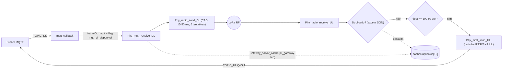

**Ponte bidirecional assíncrona.** O `mqtt_callback` (contexto do cliente MQTT) apenas copia 24 bytes para `frameDL_mqtt` e levanta `volatile bool mqtt_dl_disponivel`; o processamento e o envio por rádio acontecem no `loop()` via `Phy_mqtt_receive_DL()`, evitando operações SPI dentro do callback. Mensagens com tamanho < 24 são descartadas. O uplink é publicado de forma binária em `TOPIC_UL` com `MQTT_QOS = 1`, `retained = false`. O `loop()` também monitora Wi-Fi (`wifiMulti.run()`) e reconecta o MQTT (`conectar_mqtt()`, nova tentativa a cada 3 s). Buffer MQTT: 512 bytes. `CLIENT_ID = "BSS_Gateway " + MAC` (sem `:`).

**Prevenção de colisão e auto-eco no downlink.**

- Backoff mais agressivo: `delay(random(15, 50))`, até 5 tentativas CAD (Sensor: 25–75 ms).
- Se `frameDL.header.src_addr == 0`, preenche com `ID_gateway`; sempre sobrescreve `packet_id = ++seq_packet_gw` e `hop_limit = HOP_LIMIT_PADRAO (1)`.
- Insere preventivamente `(ID_gateway, seq_packet_gw)` no cache de duplicatas para que um eventual eco de RF do próprio downlink seja descartado.

**Filtro de duplicatas no uplink.** Buffer circular `cacheDuplicatas[CACHE_SIZE = 16]` de pares `{src, id}`, inicializado com `{0xFF, 0xFF}`, escrita em `cacheIndex = (cacheIndex + 1) % 16`. **Exceção:** `PKT_JOIN_REQUEST` não é filtrado nem inserido no cache, pois múltiplos nós virgens usam `src_addr = 0`. Após o filtro, só pacotes com `dest == ID_gateway` ou `0xFF` seguem para MQTT. Antes da publicação, `Phy_mqtt_send_UL()` carimba `rssi_ul` (Byte 5) e `snr_ul_msb/lsb` (Bytes 6–7) com as mesmas equações da Seção 3.3 (para RSSI, a condição da faixa intermediária é `<= -10.5 && >= -74`). LED verde pisca 40 ms por publicação.

## 4.3 Resiliência e Memória Não-Volátil (NVS Flash)

Namespace: **`"mot_cfg"`** (`Preferences`).

| Chave | Tipo | Gravada em | Significado |
|---|---|---|---|
| `provisionado` | Bool | `JOIN_ACCEPT` válido | Nó comissionado |
| `node_id` | UChar | `JOIN_ACCEPT` | `ID_sensor` |
| `gw_id` | UChar | `JOIN_ACCEPT` | `ID_gateway` |
| `hop_limit` | UChar | `JOIN_ACCEPT` | Limite de saltos |
| `tem_custodia` | Bool | Custódia concedida / auto-promoção por POLL (true); handover concluído (false) | Posse ativa |
| `uid_operador` | Bytes (4) | Custódia concedida (status 1) | UID do operador responsável |
| `uid_objeto` | Bytes (4) | Custódia concedida (status 1) | UID do objeto sob custódia |

**Árvore de decisão no `setup()`:**

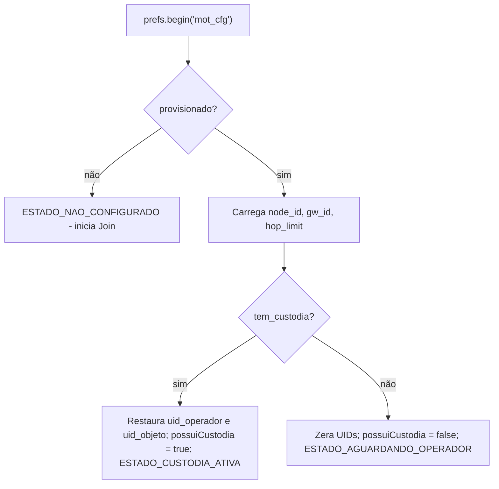

Após a decisão, `prefs.end()` e o LED verde acende por 400 ms como indicação de *boot* concluído.

---

# 5. Máquina de Estados Finitos (FSM) e Dinâmica dos Fluxos Operacionais

## 5.1 Diagrama de Estados do Nó Sensor

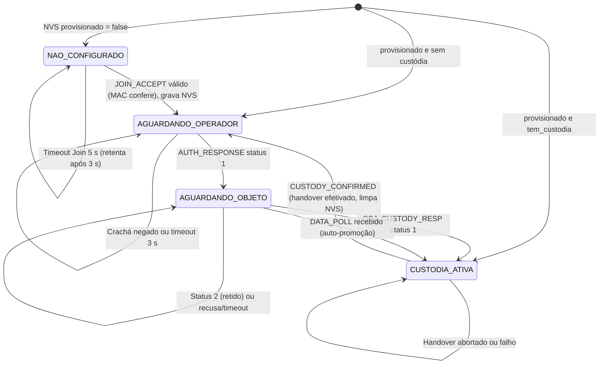

Comportamento do `loop()` por estado:

| Estado | Ações do `loop()` |
|---|---|
| `ESTADO_NAO_CONFIGURADO` | `App_executar_join()` |
| `ESTADO_AGUARDANDO_OPERADOR` | `NSS_PIN = HIGH`; `App_verificar_RFID()` (rádio isolado) |
| `ESTADO_AGUARDANDO_OBJETO` | `App_verificar_RFID()`; `Phy_radio_receive_DL()` (escuta ativa) |
| `ESTADO_CUSTODIA_ATIVA` | `Phy_radio_receive_DL()`; `App_verificar_botao_troca()` |

## 5.2 Momento 1 — Provisionamento / Join

O MAC de fábrica é lido por `esp_efuse_mac_get_default(macAddress)`. O nó envia `PKT_JOIN_REQUEST` (payload: MAC) e aguarda até **5000 ms** pelo `JOIN_ACCEPT`. No Nível 3, o MAC (formato `AA:BB:CC:DD:EE:FF`) é pesquisado em `tabela_sensores`; se ausente, atribui `proximo_id_sensor`, persiste em `sensores_cadastrados.txt` e incrementa. Se presente, reaproveita o ID (idempotência). O `JOIN_ACCEPT` (dest `0xFF`) contém MAC, `assigned_id`, `ID_GATEWAY = 100` e `HOP_LIMIT_PADRAO = 1`. O nó valida com `memcmp(mac, macAddress, 6)`, grava NVS e avança para `AGUARDANDO_OPERADOR`. Em timeout, aguarda 3 s e retenta.

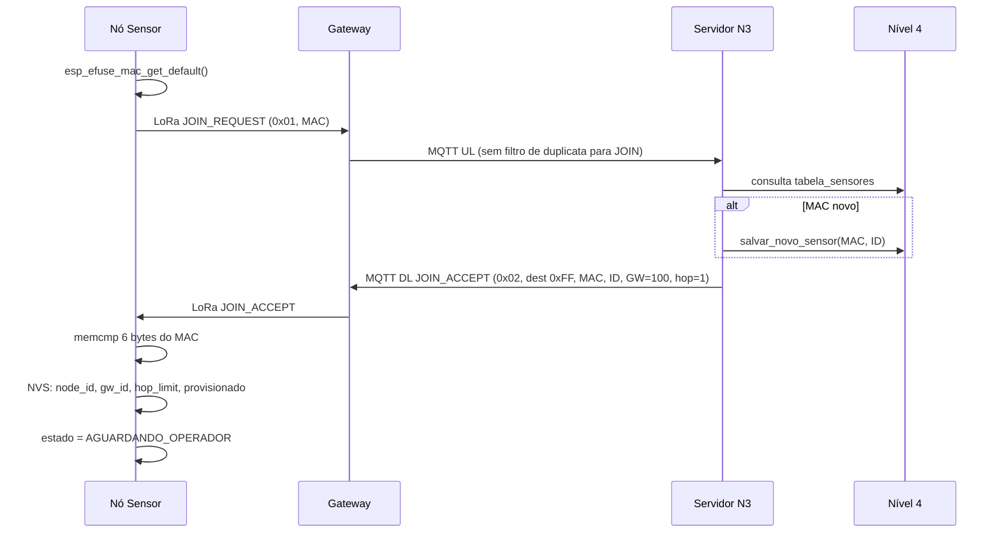

## 5.3 Momentos 2A e 2B — Autenticação em Duas Etapas e Disputa de Posse

**2A (Operador).** O nó lê o RFID (UID de 4 bytes) e envia `AUTH_REQUEST`; aguarda **3000 ms**. O Nível 3 recarrega `pessoas.csv`, consulta o UID (maiúsculas, bytes separados por espaço) e aprova somente se existir e `status == "ativo"`, registrando `operadores_autenticados[sensor_id]`. A resposta é `AUTH_RESPONSE` com `auth_status` 1 ou 0. Com 1, o nó faz LED verde 600 ms e entra em `AGUARDANDO_OBJETO`.

**2B (Objeto).** O nó entra no **laço travante**: `NSS_PIN` mantido em HIGH, leitura RFID com `delay(20)` e `yield()`, sem recepção de rádio, até detectar a tag do objeto. Em seguida envia `OBJ_CUSTODY_REQ` (UID operador + UID objeto) e aguarda **3000 ms**. O Nível 3 varre `sessoes_ativas` buscando o `uid_objeto`:

| Cenário | Condição no Nível 3 | Resposta | Efeito |
|---|---|---|---|
| **Status 1 — Concedido** | Objeto livre (ou já do mesmo nó) | `OBJ_CUSTODY_RESP`, byte 21 = 1 | Cria `sessoes_ativas[sensor_id]` (`uid_objeto`, `uid_operador`, `responsavel`, `inicio_sessao`, `ultimo_visto`, `pausado_troca=False`) e persiste JSON; nó assume custódia e grava NVS |
| **Status 2 — Retido** | Objeto em sessão de outro nó | `OBJ_CUSTODY_RESP`, byte 21 = 2 | Cria `intencoes_pendentes[uid_objeto] = {node_id, uid_operador}`; nó fica em escuta passiva (LED amarelo 4×) |
| **Status 0 / Timeout** | Sem resposta ou recusa | — | LED vermelho 1000 ms; permanece em `AGUARDANDO_OBJETO` |

**Retentativa:** em `AGUARDANDO_OBJETO`, uma nova leitura de tag (ramo "ETAPA 2" de `App_verificar_RFID`) refaz a requisição de custódia com 3000 ms de janela.

**Auto-promoção.** Se um nó em `AGUARDANDO_OBJETO` (sem custódia) receber um `PKT_DATA_POLL` — evidência de que o servidor já criou sessão para ele (p.ex., resposta de status 1 perdida no RF) — ele assume `possuiCustodia = true`, estado `CUSTODIA_ATIVA`, grava `tem_custodia = true` na NVS e responde ao polling.

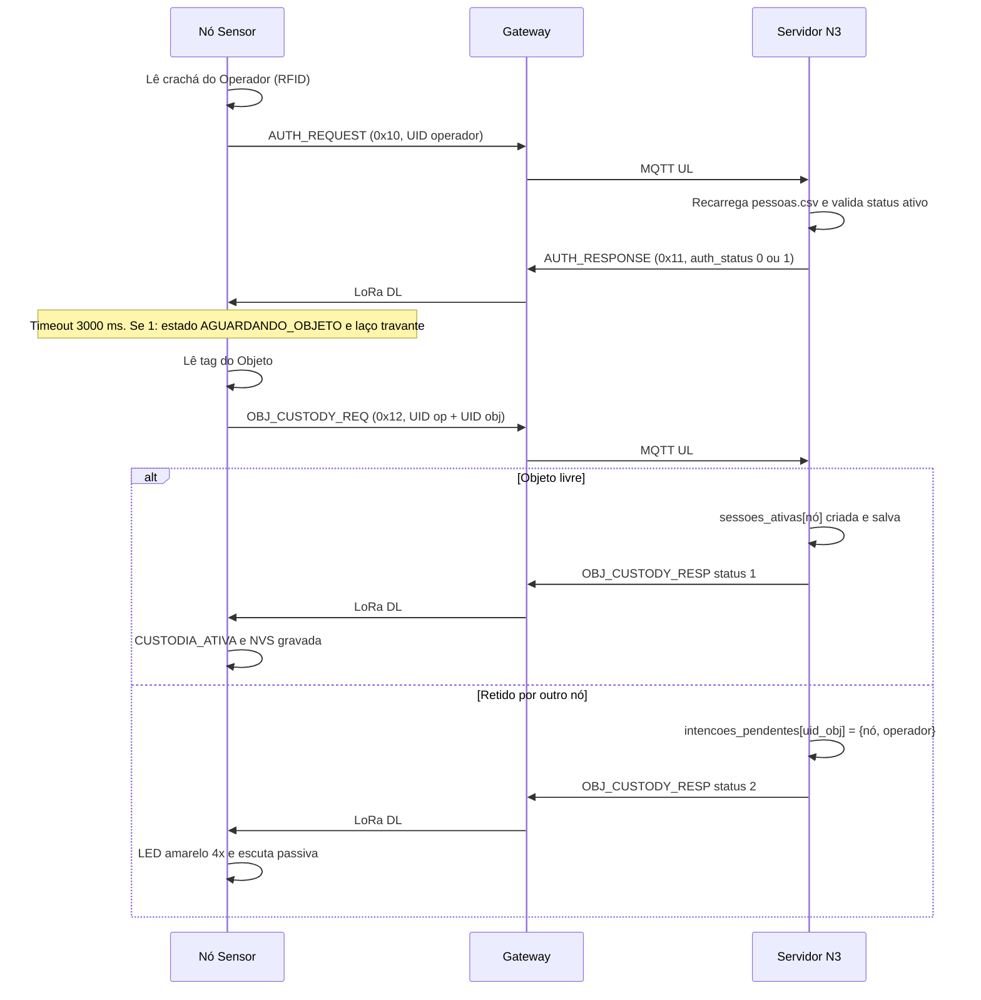

## 5.4 Momento 3 — Operação Telemétrica por Polling Centralizado

A cada `INTERVALO_POLLING_SEGUNDOS = 5.0`, o Nível 3 percorre `sessoes_ativas` e, para cada nó com `pausado_troca == False`, envia `PKT_DATA_POLL` (dest = `node_id`), com `time.sleep(0.1)` entre nós. O nó responde com `DATA_REPLY` (DHT22, contadores TRANSP, `hw_code = 1`, 3 bytes do UID do objeto) e atualiza o display. No servidor, `tratar_data_reply` atualiza `ultimo_visto`, decodifica RSSI/SNR (DL/UL), temperatura, umidade e UID parcial, imprime a telemetria e grava uma linha no CSV de sessão (com flush imediato).

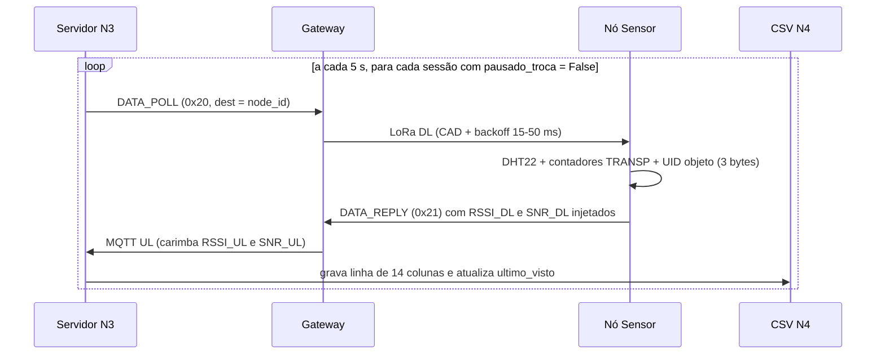

## 5.5 Momento 4 — Protocolo de Handover Físico (Transferência Segura de Custódia)

**Pré-condição:** o Receptor já solicitou a posse e o Nível 3 registrou `intencoes_pendentes[uid_objeto]` (status 2).

1. **Gatilho (Cedente):** botão (`GPIO 39`, LOW) pressionado por ≥ **3000 ms**; o nó espera a soltura do botão e inicia o processo.
2. **`PKT_CUSTODY_START` (0x30):** envia `uid_objeto`; o Nível 3 marca `pausado_troca = True` e persiste, suspendendo o polling daquele nó.
3. **Passo 1 (janela 20000 ms):** o Cedente deve aproximar a tag do **objeto** sob custódia; `memcmp` com `uid_objeto`. LED amarelo pisca a cada 300 ms. Falha/timeout/objeto incorreto → `PKT_CUSTODY_ABORT` + LED vermelho 3× (rollback).
4. **Passo 2 (janela 20000 ms):** o Cedente lê o **crachá do Novo Operador**. Timeout → `PKT_CUSTODY_ABORT` + rollback.
5. **`PKT_HANDOVER_AGREED` (0x33):** envia `uid_objeto` + `uid_novo_op` e aguarda até **4000 ms** por `CUSTODY_CONFIRMED`.
6. **Validação cruzada (Nível 3, `tratar_handover`):** busca `intencoes_pendentes[uid_objeto]`; se existir e `uid_novo_op == intencao["uid_operador"]`, efetiva.
7. **Disparo duplo:** (a) `PKT_CUSTODY_CONFIRMED` (0x31) ao Cedente; após 0,1 s, (b) `PKT_OBJ_CUSTODY_RESP` status 1 (com UID do novo operador e do objeto) ao Receptor. O servidor remove a sessão do Cedente, cria a do Receptor (`pausado_troca = False`), persiste e remove a intenção.
8. **No Cedente:** ao receber `CUSTODY_CONFIRMED`, LED verde 1000 ms, `tem_custodia = false` na NVS, zera `possuiCustodia`, `uid_operador` e `uid_objeto`, estado → `AGUARDANDO_OPERADOR`.
9. **No Receptor:** ao receber `OBJ_CUSTODY_RESP` status 1 em `AGUARDANDO_OBJETO`, assume `CUSTODIA_ATIVA` e grava NVS; passa a ser consultado pelo polling.
10. **Rollback:** em `PKT_CUSTODY_ABORT`, o servidor volta `pausado_troca = False` e retoma o polling. Se o Cedente não receber confirmação em 4000 ms, mantém a custódia local (LED vermelho 3×, 150 ms) — ver observação O-3 sobre o estado do servidor nesse caso.

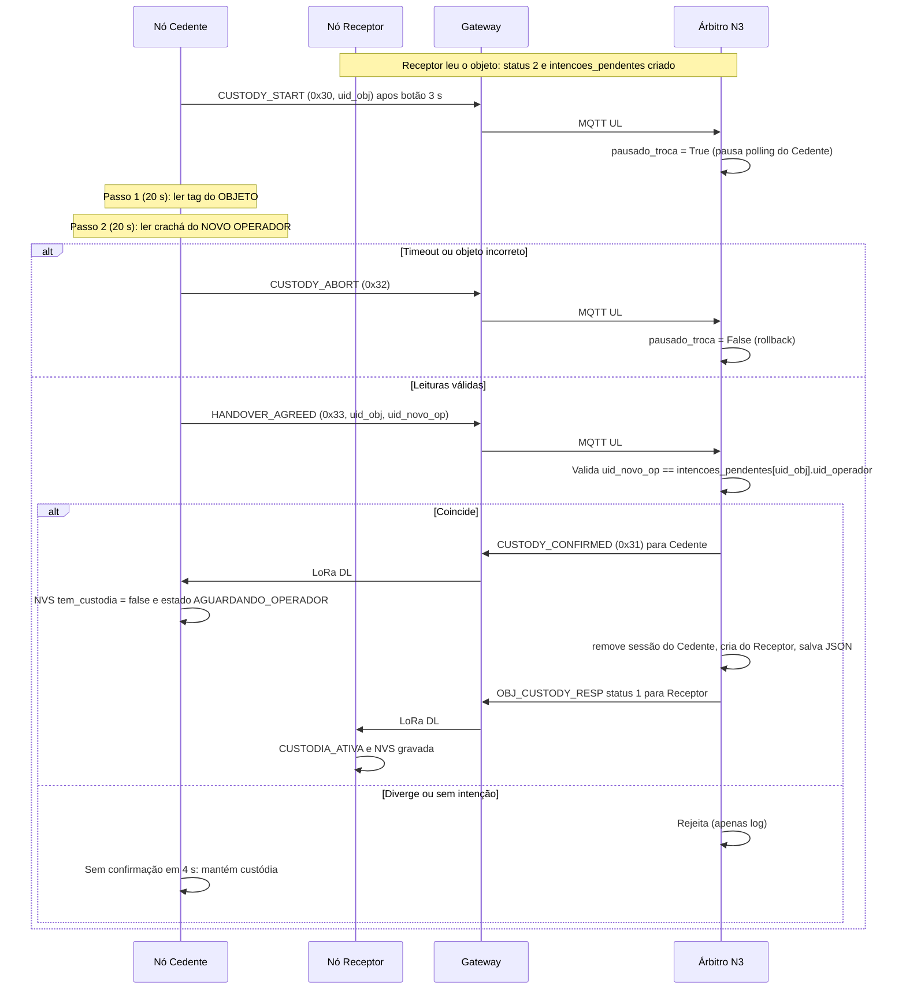

---

# 6. Servidor Central Nível 3 (`main.py`) e Camada de Dados Nível 4

## 6.1 Abstração de Transporte

`main.py` seleciona, em tempo de execução, uma implementação com a mesma interface (`conectar`, `enviar_pacote`, `receber_pacote`, `desconectar`) — polimorfismo por *duck typing*.

| Aspecto | `GerenciadorSerial` | `GerenciadorMQTT` |
|---|---|---|
| Modo | `[1]` Direta USB (porta `COM<n>`) | `[2]` Nuvem |
| Parâmetros | 115200 bps, `timeout_serial = 0.5` s, sem paridade | Broker `localhost:1883`, `keepalive = 60`, QoS 1 |
| Tópicos | n/a | DL `mot_lora_mqtt/gateway/downlink`; UL `mot_lora_mqtt/gateway/uplink` |
| Inicialização | `resetar_esp32()`: DTR/RTS False → 0,1 s → True → 1,5 s → limpa buffers | `loop_start()` (thread em segundo plano) + `sleep(1.5)` |
| Envio | Limpa buffers, `write(bytearray)`, `flush()` | `publish(...)` + `wait_for_publish(timeout=2)` |
| Recepção | Lê até 24 bytes ou estouro do timeout; falha → limpa buffers e retorna `None` | `on_message` copia os primeiros 24 bytes e aciona `threading.Event`; `receber_pacote` aguarda o evento |
| Retorno | `list[int]` ou `None` | `list[int]` ou `None` |
| API paho | n/a | `CallbackAPIVersion.VERSION2` |

O laço principal chama `receber_pacote(timeout=0.1)` e despacha por `pkt_type` (`0x01`, `0x10`, `0x12`, `0x33`, `0x30/0x32`, `0x21`), validando `len == 24`.

## 6.2 Estruturas de Estado em Tempo de Execução

| Estrutura | Tipo | Chave → Valor | Papel |
|---|---|---|---|
| `tabela_sensores` | `dict` | `MAC (str "AA:BB:...")` → `node_id (int)` | Cache do comissionamento; espelhado em `sensores_cadastrados.txt` |
| `proximo_id_sensor` | `int` | — | `max(id)+1` (mínimo 1) |
| `CADASTRO_PESSOAS` | `dict` | `UID "XX XX XX XX"` → `{nome, email, telefone, chave_publica, status}` | Base cadastral recarregada a cada `AUTH_REQUEST` |
| `sessoes_ativas` | `dict` | `node_id (int)` → `{uid_objeto, uid_operador, responsavel, inicio_sessao, ultimo_visto, pausado_troca}` | Define *quem recebe polling*; persistido em `sessoes_ativas.json` e restaurado no reinício |
| `operadores_autenticados` | `dict` | `node_id` → `uid_operador` | Registro de logins aprovados em RAM |
| `intencoes_pendentes` | `dict` | `uid_objeto` → `{node_id, uid_operador}` | Pedidos de posse de objeto retido, validados no handover |
| `seq_packet_gw` | `int` | — | Contador de `packet_id` do Python (0–255); o Gateway o sobrescreve no DL |

## 6.3 Camada de Persistência (`N4.py`)

Diretório base: `<dir do script>/../N4`.

| Artefato | Caminho | Formato | Conteúdo |
|---|---|---|---|
| Pessoas | `N4/Parametros/pessoas.csv` | CSV: `tag_uid, nome, email, telefone, chave_publica, status` | Criado com cabeçalho e 2 exemplos se ausente; UID normalizado em maiúsculas; linhas iniciadas por `#` ignoradas |
| Sensores | `N4/Parametros/sensores_cadastrados.txt` | Texto: `MAC,ID` por linha | `#` = comentário; *append* em `salvar_novo_sensor` |
| Sessões | `N4/Parametros/sessoes_ativas.json` | JSON (indent 2) | Chaves convertidas para `int` ao carregar |
| Logs | `N4/Dados_Brutos/Sessao_MoT_YYYY_MM_DD_HH-MM-SS.csv` | CSV (UTF-8) | Uma linha por `DATA_REPLY` |

Funções: `garantir_diretorios`, `carregar_pessoas`, `carregar_sensores_cadastrados`, `salvar_novo_sensor`, `carregar_sessoes_ativas`, `salvar_sessoes_ativas`. Ao encerrar (`KeyboardInterrupt`), o log é fechado e as sessões são salvas.

## 6.4 Esquema de Dados e Auditoria — CSV de Logs Brutos (14 colunas)

| # | Coluna | Origem | Descrição |
|---|---|---|---|
| 1 | `Timestamp` | Servidor | `YYYY-MM-DD HH:MM:SS` |
| 2 | `Tipo_Pkt` | Byte 1 | Formato `0xNN` (na prática `0x21`) |
| 3 | `ID_Origem` | Byte 9 | `node_id` |
| 4 | `ID_Destino` | Byte 10 | Normalmente o ID do Gateway |
| 5 | `Packet_ID` | Byte 8 | Sequência de 8 bits |
| 6 | `RSSI_DL` | Byte 2 | dBm (medido no sensor) |
| 7 | `SNR_DL` | Bytes 3–4 | dB |
| 8 | `RSSI_UL` | Byte 5 | dBm (medido no gateway) |
| 9 | `SNR_UL` | Bytes 6–7 | dB |
| 10 | `Temp_C` | Byte 19 | °C ou vazio/`None` |
| 11 | `Umidade_Pct` | Byte 20 | % ou vazio/`None` |
| 12 | `UID_Objeto` | Bytes 21–23 | UID parcial (3 bytes) |
| 13 | `Responsavel` | `sessoes_ativas` | Nome do operador ou "Sem Custódia" |
| 14 | `Raw_Hex` | Bytes 0–23 | Frame completo em hexadecimal |

# 7. Referências

[1] YAMAGUTI, R. et al. IoT and Blockchain for Support
for Smart Contracts Through TpM. Sensors, v. 25,
n. 16, art. 5001, 2025.
https://doi.org/10.3390/s25165001